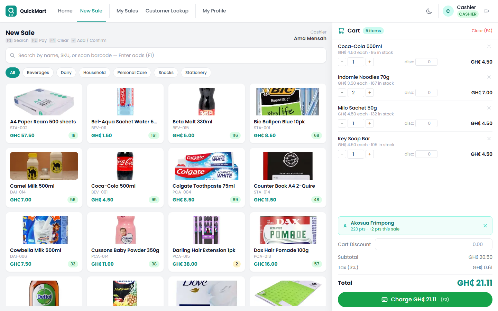
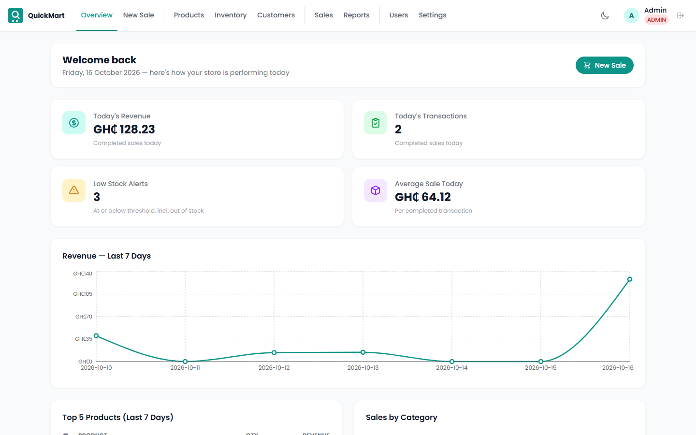
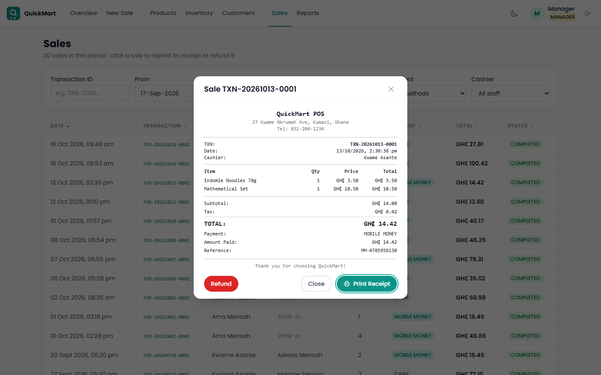
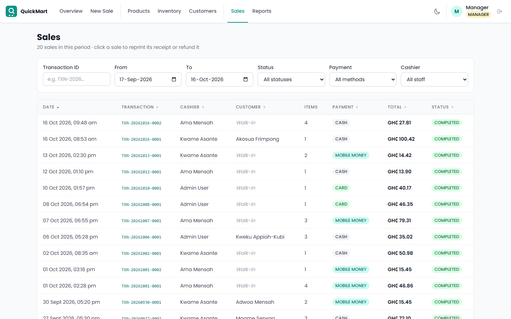
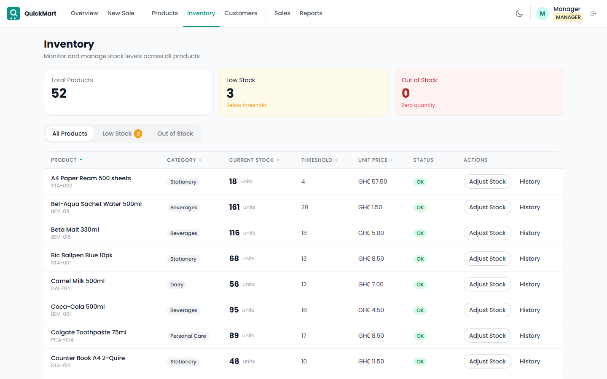
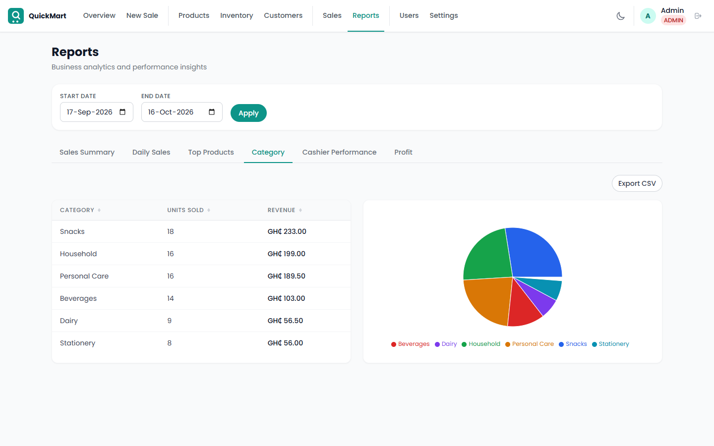
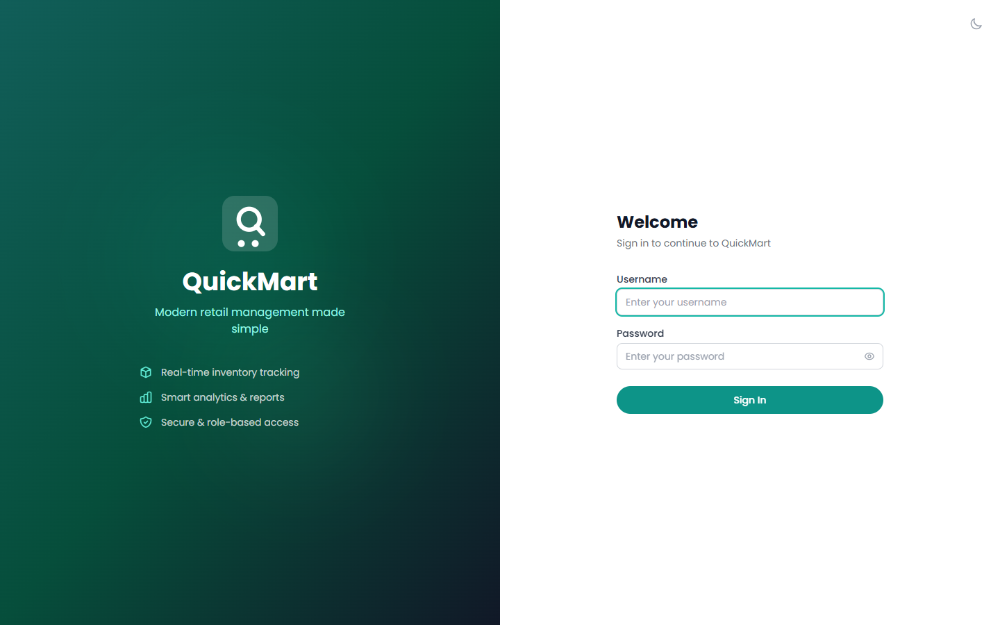

# QuickMart POS

A web-based point of sale system for a retail shop, built as a final-year capstone project. Cashiers ring up sales from the keyboard or a barcode scanner. Managers run the stock, customers and refunds, and admins see the reports and control users and settings.

**Stack:** React + Vite + Tailwind CSS · Node.js + Express · PostgreSQL + Prisma · JWT auth



---

## Features

**Point of sale**
- Search by name, SKU, or barcode. A scanned or typed barcode plus **Enter** adds the product straight to the cart.
- Browse products by category. Stock badges warn when an item is running low.
- Cart with per-item and cart-wide discounts, tax (configurable), and an optional customer for loyalty points. Walk-in sales need no customer.
- Payment by cash (with one-tap "Exact" and rounded-up amount buttons, and change calculation), Mobile Money, or card. Mobile Money and card payments go through Paystack and are verified on the server.
- An 80mm thermal receipt is printed with `window.print()`.
- Keyboard shortcuts: **F1** search, **F2** pay, **F4** clear cart, **Enter** add / confirm.

**Back office**
- **Dashboard.** Today's revenue, today's transaction count, low-stock alerts, a 7-day revenue chart, top products, and sales by category.
- **Sales.** Filter by date, status, payment method, cashier, or transaction ID. Reprint any receipt, and refund sales (stock and loyalty points are reversed).
- **Products.** Create, edit, image upload, categories, suppliers, and soft delete/reactivate (admin).
- **Inventory.** Stock levels, low and out-of-stock views, restock and adjustments, plus each product's full stock history.
- **Customers.** Loyalty points, lifetime spend, and purchase history.
- **Reports.** Sales summary, daily sales, top products, category, cashier performance, and profit. All support date ranges and CSV export.
- **Users and settings (admin).** Roles, deactivation, password resets, and unlocking accounts. Store details, tax rate, loyalty rate, currency symbol, and receipt footer.

**Built to be correct under real use**
- Every sale is one database transaction. Stock can't oversell even when two tills sell the last unit at once, and every stock change is logged.
- Role-based access is enforced on every endpoint: ADMIN, MANAGER, CASHIER.
- Passwords use bcrypt (cost 12). Access tokens last 15 minutes; refresh tokens last 7 days, rotate on each use, and live in an httpOnly cookie.
- Accounts lock after 5 failed logins until an admin unlocks them. Every login, logout and lockout is recorded in an auth log.
- All input is validated on the server, including rejecting fields an endpoint doesn't expect. Login is rate-limited, and the database itself refuses negative stock and amounts.

---

## Screenshots

| | |
|---|---|
|  **Dashboard**: today's figures and trends |  **Receipt**: reprint or refund from the Sales page |
|  **Sales**: filterable, sortable history |  **Inventory**: stock levels and adjustments |
|  **Reports**: charts and CSV export |  **Login** |

---

## Getting started

**Prerequisites:** Node.js 20+, npm 10+, PostgreSQL 15+.

```bash
# 1. Database
createdb -U postgres pos_db

# 2. Backend
cd server
npm install
cp .env.example .env          # then edit DATABASE_URL and the two JWT secrets
npx prisma migrate deploy     # create the tables
npx prisma db seed            # sample data: 52 products, 10 customers, 20 sales
npm run dev                   # API on http://localhost:3001

# 3. Frontend (second terminal)
cd client
npm install
npm run dev                   # app on http://localhost:5173
```

Log in at http://localhost:5173:

| Role | Username | Password | Lands on |
|---|---|---|---|
| Admin | `admin` | `admin123` | Dashboard, with every page available |
| Manager | `manager` | `manager123` | Dashboard, without Users and Settings |
| Cashier | `cashier` | `cashier123` | Cashier home, New Sale, My Sales |

[docs/SETUP.md](docs/SETUP.md) covers the details: creating a dedicated database user, Paystack keys, every script, production deployment, and troubleshooting.

---

## Environment variables

**`server/.env`**

| Variable | Required | Default | Purpose |
|---|---|---|---|
| `DATABASE_URL` | ✓ | — | PostgreSQL connection string |
| `JWT_ACCESS_SECRET` | ✓ | — | Signs access tokens (256-bit random string) |
| `JWT_REFRESH_SECRET` | ✓ | — | Signs refresh tokens (a different 256-bit string) |
| `JWT_ACCESS_EXPIRES_IN` | | `15m` | Access token lifetime |
| `JWT_REFRESH_EXPIRES_IN` | | `7d` | Refresh token lifetime |
| `PORT` | | `3001` | API port |
| `NODE_ENV` | | `development` | `production` enables secure cookies and hides error details |
| `CORS_ORIGIN` | | `http://localhost:5173` | The only origin allowed to call the API |
| `PAYSTACK_SECRET_KEY` | for card/MoMo | — | Verifies Paystack payments server-side |
| `TRUST_PROXY` | behind a proxy | — | `1` behind nginx/Caddy, so client IPs are correct |

Generate a secret with `node -e "console.log(require('crypto').randomBytes(32).toString('hex'))"`.

**`client/.env.local`** (optional): `VITE_PAYSTACK_PUBLIC_KEY`, the Paystack public key for the card and Mobile Money popup. Cash sales work without it.

Store name, address, phone, tax rate, loyalty rate and currency symbol aren't environment variables. Admins change them on the **Settings** page.

---

## Database commands

Run these in `server/`:

```bash
npx prisma migrate deploy        # apply migrations (fresh setup)
npm run db:migrate               # create + apply a migration after editing prisma/schema.prisma
npm run db:seed                  # wipe everything and reload the sample data
npm run db:studio                # browse the data in Prisma Studio
npm run db:backup                # pg_dump to server/backups/pos_backup_<timestamp>.dump
npm run db:restore -- --file backups/<file>.dump
npm run unlock-user -- <username>   # unlock an account if no admin can log in
```

The schema and the reasoning behind it are in [docs/DATABASE.md](docs/DATABASE.md).

---

## Tests

```bash
cd server && npm test     # Jest + Supertest integration tests (uses the database in .env)
cd client && npm test     # Vitest component and utility tests
```

The backend tests cover authentication, account lockout and token rotation; sales (cash, mobile money, discounts, concurrent sales, refunds); inventory (restock, adjustments, concurrency); and request validation. They create and delete their own data, and mock Paystack.

---

## API

REST and JSON at `http://localhost:3001/api`. Every response has the shape `{ success, data, message }` or `{ success: false, error: { code, message, details } }`. List endpoints take `page`, `per_page`, `sort` and `order`.

| Module | Endpoints |
|---|---|
| Auth | `POST /auth/login` · `/auth/logout` · `/auth/refresh` · `GET /auth/me` · `PUT /auth/profile` · `POST /auth/change-password` |
| Products | `GET, POST /products` · `GET, PUT, DELETE /products/:id` · `GET /products/barcode/:code` |
| Categories / Suppliers | `GET, POST /categories` · `PUT /categories/:id` · `GET, POST /suppliers` · `GET, PUT, DELETE /suppliers/:id` |
| Inventory | `GET /inventory` · `GET /inventory/low-stock` · `POST /inventory/restock` · `POST /inventory/adjust` · `GET /inventory/log/:productId` |
| Sales | `GET, POST /sales` · `GET /sales/:id` · `GET /sales/:id/receipt` · `POST /sales/:id/refund` |
| Customers | `GET, POST /customers` · `GET, PUT /customers/:id` · `GET /customers/:id/purchases` |
| Reports | `/reports/dashboard` · `sales-summary` · `sales-by-day` · `top-products` · `category-performance` · `cashier-performance` · `inventory-status` · `profit` · `cashier-stats` |
| Users | `GET /users/staff` · `GET, POST /users` · `PUT /users/:id` · `POST /users/:id/reset-password` · `POST /users/:id/unlock` |
| Settings | `GET, PUT /settings` |

Request bodies, query parameters, roles and error codes: [docs/API.md](docs/API.md).

---

## Project structure

```
client/   React app: pages/, components/, context/ (auth, cart, settings), services/ (API calls)
server/   Express API: routes/ → controllers/ → services/ (business logic), middleware/, prisma/
docs/     API.md, DATABASE.md, SETUP.md, screenshots/
```

A fuller tree is in [docs/SETUP.md](docs/SETUP.md#project-structure).

Currency is Ghana Cedis by default, shown as `GH₵ 1,234.56`; the symbol can be changed in Settings.
