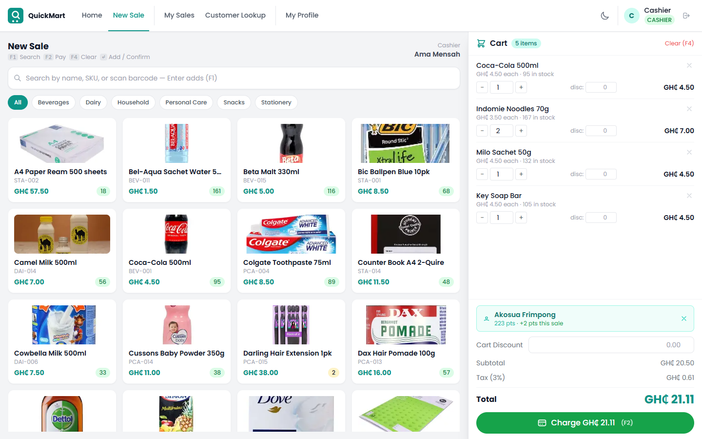
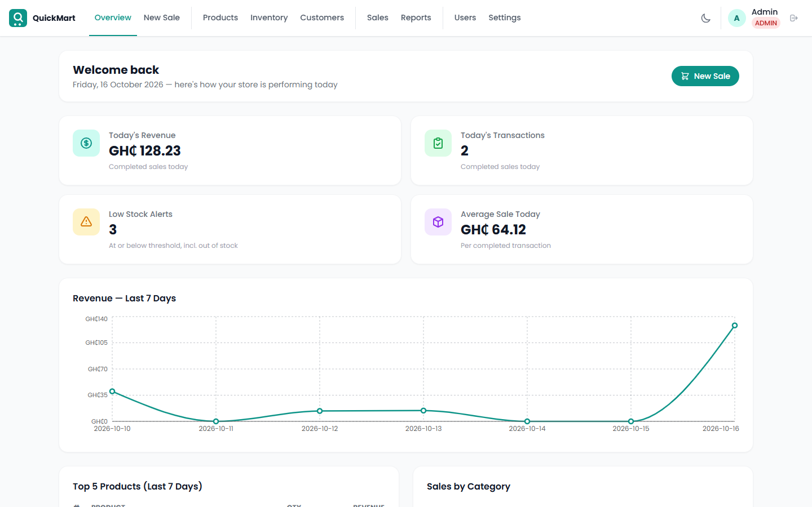
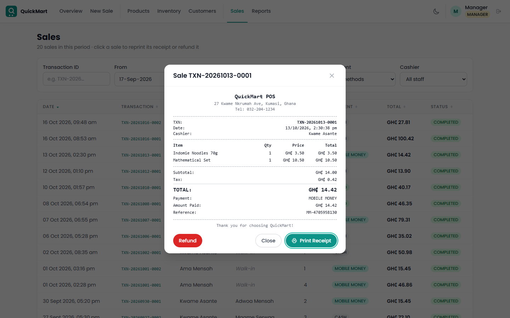
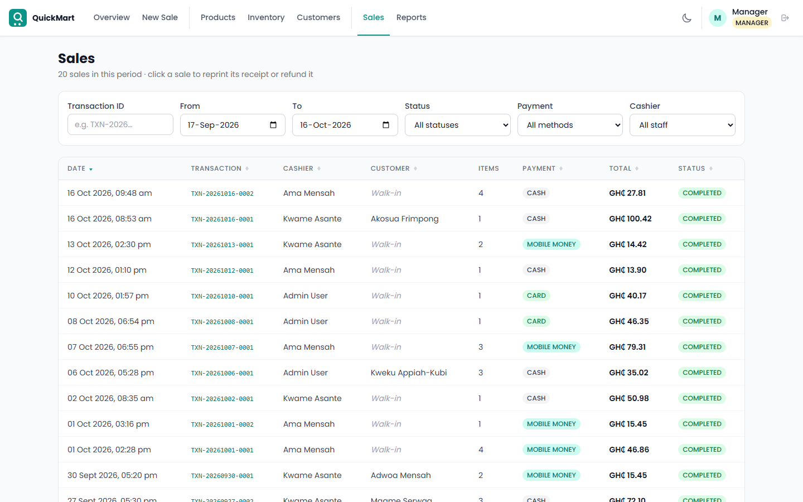
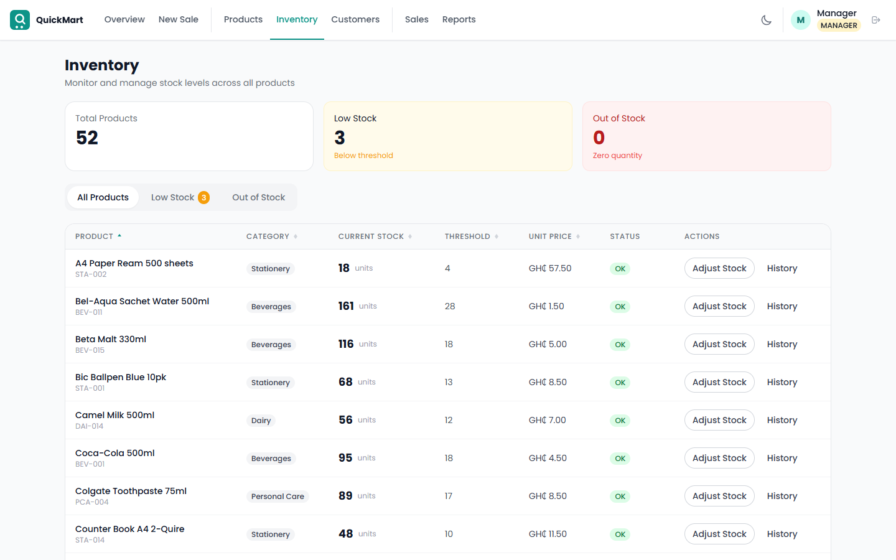
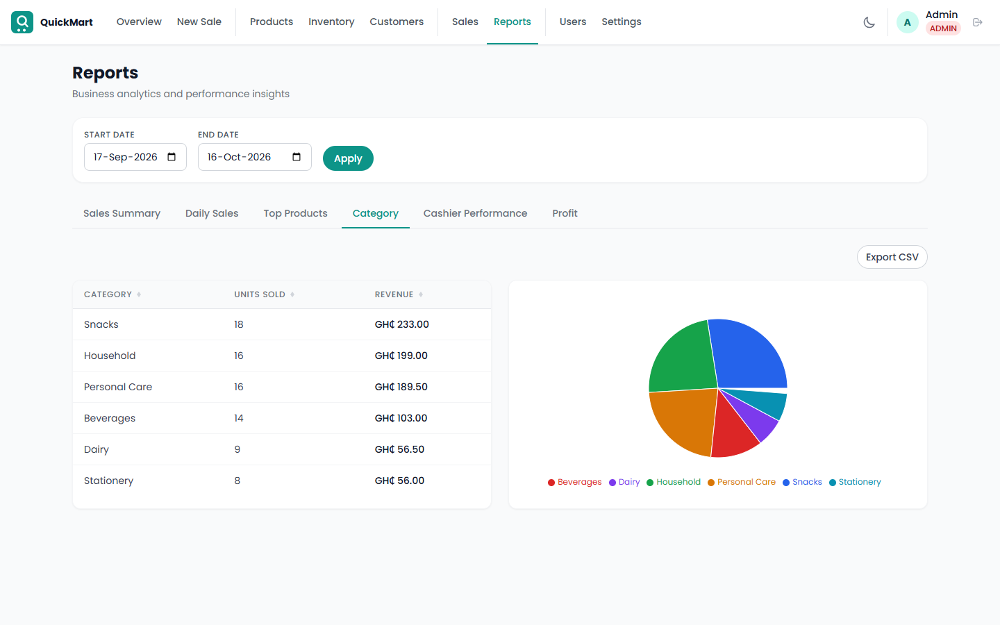
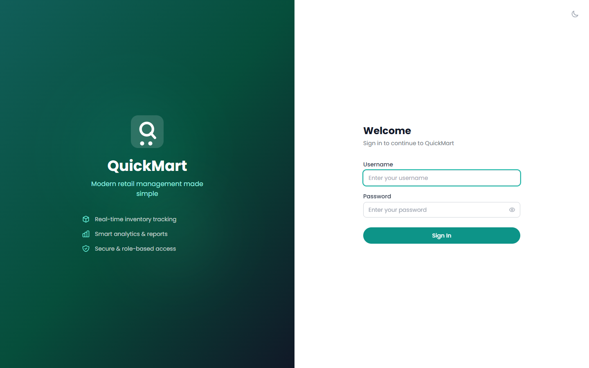

# QuickMart POS

[](https://github.com/obfdanso/POS/actions/workflows/ci.yml)

A web-based point of sale system for a retail shop, built as a final-year capstone project. Cashiers ring up sales from the keyboard or a barcode scanner. Managers run the stock, customers and refunds, and admins see the reports and control users and settings.

**Stack:** React + Vite + Tailwind CSS · Node.js + Express · PostgreSQL + Prisma · JWT auth



---

## Features

**Point of sale**
- Search by name, SKU, or barcode. A scanned or typed barcode plus **Enter** adds the product straight to the cart.
- Browse products by category. Stock badges warn when an item is running low.
- Cart with per-item and cart-wide discounts, tax (configurable), and an optional customer for loyalty points. Walk-in sales need no customer.
- **Promotions** apply automatically: a percentage off one product, a category, or the whole store, for a set period. Product cards show the deal, cart lines show the saving, and receipts name the promotion.
- **Loyalty redemption.** Customers can spend their points as money off at the till (the point value is set by an admin). Returned goods give the points back.
- Payment by cash (with one-tap "Exact" and rounded-up amount buttons, and change calculation), Mobile Money, or card. Mobile Money and card payments go through Paystack and are verified on the server.
- **Split payments.** One sale can be paid partly by Mobile Money or card and the rest in cash, with change worked out from the cash part. Shifts count each part under its own method, and refunds give the cash back first.
- An 80mm thermal receipt is printed with `window.print()`, emailed to the customer when an SMTP server is configured, or texted to their phone when an SMS provider (Arkesel or Twilio) is configured. Both default to the customer's address or number on file.
- **Installable app.** QuickMart can be installed from the browser on a tablet or desktop and opens in its own window. Its screens load even when the connection drops, and a banner warns that nothing can be saved until it's back.
- Keyboard shortcuts: **F1** search, **F2** pay, **F4** clear cart, **Enter** add / confirm.
- **Cash drawer shifts.** Cashiers open a shift with a counted float and close it by counting the drawer. The system works out the expected cash (float + cash sales − cash refunds) and records whether the drawer was over or short. Admins can make an open shift required before selling.

**Back office**
- **Dashboard.** Today's revenue, today's transaction count, low-stock alerts, a 7-day revenue chart, top products, and sales by category.
- **Sales.** Filter by date, status, payment method, cashier, or transaction ID. Reprint any receipt, and return some or all of a sale: choose items and quantities, decide whether each goes back on the shelf or was damaged, and give a reason. Each item is refunded at its share of what the customer paid, and stock and loyalty points are adjusted. Every return can be printed as a refund slip for the customer to sign.
- **Shifts.** Every drawer session with its float, takings by payment method, expected and counted cash, and the over/short result. Managers can close a shift a cashier left open.
- **Products.** Create, edit, image upload, categories, suppliers, and soft delete/reactivate (admin).
- **Inventory.** Stock levels, low and out-of-stock views, restock and adjustments, plus each product's full stock history.
- **Purchase orders.** Order stock from a supplier (with one-click suggestions for its low-stock products), then receive deliveries in full or in parts. Received goods go straight into stock with a log entry and can update the cost price used in profit reports.
- **Promotions.** Create, schedule, edit and switch off automatic discounts, and see how often each was used.
- **Customers.** Loyalty points, lifetime spend, and purchase history.
- **Reports.** Sales summary, daily sales, top products, category, cashier performance, and profit. All support date ranges and CSV export.
- **Users and settings (admin).** Roles, deactivation, password resets, and unlocking accounts. Store details, tax rate, loyalty rate and point value, currency symbol, and receipt footer.

**Built to be correct under real use**
- Every sale is one database transaction. Stock can't oversell even when two tills sell the last unit at once, a Paystack payment can only pay for one sale, and every stock change is logged.
- Role-based access is enforced on every endpoint: ADMIN, MANAGER, CASHIER.
- Passwords use bcrypt (cost 12). Access tokens last 15 minutes; refresh tokens last 7 days, rotate on each use, and live in an httpOnly cookie.
- Accounts lock after 5 failed logins until an admin unlocks them, and changing a password signs out every other device. Logins go to an auth log; refunds, shift closes, deactivations, deletions and settings or user changes go to an audit log with who made them.
- Every request gets an ID that appears in its log lines and in unexpected-error messages, so a problem a cashier reports can be found in the logs. `/api/health/ready` checks the database for Docker and uptime monitors. With a Sentry DSN set, unexpected server errors and browser crashes are reported to Sentry, without tokens, cookies, request bodies or customer searches.
- All input is validated on the server, including rejecting fields an endpoint doesn't expect. Login is rate-limited, and the database itself refuses negative stock and amounts.

---

## Screenshots

| | |
|---|---|
|  **Dashboard**: today's figures and trends |  **Receipt**: reprint or refund from the Sales page |
|  **Sales**: filterable, sortable history |  **Inventory**: stock levels and adjustments |
|  **Reports**: charts and CSV export |  **Login** |

---

## Getting started

**Prerequisites:** Node.js 20+, npm 10+, PostgreSQL 15+.

```bash
# 1. Database
createdb -U postgres pos_db

# 2. Backend
cd server
npm install
cp .env.example .env          # then edit DATABASE_URL and the two JWT secrets
npx prisma migrate deploy     # create the tables
npx prisma db seed            # sample data: 52 products, 10 customers, 20 sales
npm run dev                   # API on http://localhost:3001

# 3. Frontend (second terminal)
cd client
npm install
npm run dev                   # app on http://localhost:5173
```

Log in at http://localhost:5173:

| Role | Username | Password | Lands on |
|---|---|---|---|
| Admin | `admin` | `admin123` | Dashboard, with every page available |
| Manager | `manager` | `manager123` | Dashboard, without Users and Settings |
| Cashier | `cashier` | `cashier123` | Cashier home, New Sale, My Sales |

### Or run everything with Docker

**Prerequisites:** Docker with Compose v2.

```bash
cp .env.docker.example .env                 # then set POSTGRES_PASSWORD and the two JWT secrets
docker compose up --build -d                # database, API and web app
docker compose exec server npx prisma db seed   # first run only: sample data
```

The app is at http://localhost:8080. Migrations run automatically each time the server container starts. Data and uploaded images are kept in the `pgdata` and `uploads` volumes. To reach it from tablets over plain HTTP on the shop network, set `COOKIE_SECURE=false` in `.env`.

[docs/SETUP.md](docs/SETUP.md) covers the details: creating a dedicated database user, Paystack keys, every script, production deployment, and troubleshooting.

---

## Environment variables

**`server/.env`**

| Variable | Required | Default | Purpose |
|---|---|---|---|
| `DATABASE_URL` | ✓ | — | PostgreSQL connection string |
| `JWT_ACCESS_SECRET` | ✓ | — | Signs access tokens (256-bit random string) |
| `JWT_REFRESH_SECRET` | ✓ | — | Signs refresh tokens (a different 256-bit string) |
| `JWT_ACCESS_EXPIRES_IN` | | `15m` | Access token lifetime |
| `JWT_REFRESH_EXPIRES_IN` | | `7d` | Refresh token lifetime |
| `PORT` | | `3001` | API port |
| `NODE_ENV` | | `development` | `production` enables secure cookies and hides error details |
| `CORS_ORIGIN` | | `http://localhost:5173` | The only origin allowed to call the API |
| `PAYSTACK_SECRET_KEY` | for card/MoMo | — | Verifies Paystack payments server-side |
| `TRUST_PROXY` | behind a proxy | — | `1` behind nginx/Caddy, so client IPs are correct |
| `COOKIE_SECURE` | | follows `NODE_ENV` | `false` allows refresh cookies over plain HTTP on a private network |
| `SMTP_HOST`, `SMTP_PORT`, `SMTP_SECURE`, `SMTP_USER`, `SMTP_PASS`, `MAIL_FROM` | for emailed receipts | — | Any SMTP provider. Leave `SMTP_HOST` empty to turn email off |
| `SMS_PROVIDER` (`arkesel` or `twilio`), `ARKESEL_API_KEY`, `SMS_SENDER_ID`, `TWILIO_ACCOUNT_SID`, `TWILIO_AUTH_TOKEN`, `TWILIO_FROM` | for texted receipts | — | Leave `SMS_PROVIDER` empty to turn texts off |
| `SMS_COUNTRY_CODE`, `SMS_ALLOWED_COUNTRY_CODES` | | `233`, — | Country code for local numbers; only that country can be texted unless more are listed |
| `SENTRY_DSN` (server), `VITE_SENTRY_DSN` (client) | | — | Optional error reporting to Sentry. The browser SDK is only downloaded when set |

Generate a secret with `node -e "console.log(require('crypto').randomBytes(32).toString('hex'))"`.

**`client/.env.local`** (optional): `VITE_PAYSTACK_PUBLIC_KEY`, the Paystack public key for the card and Mobile Money popup. Cash sales work without it.

Store name, address, phone, tax rate, loyalty rate and currency symbol aren't environment variables. Admins change them on the **Settings** page.

---

## Database commands

Run these in `server/`:

```bash
npx prisma migrate deploy        # apply migrations (fresh setup)
npm run db:migrate               # create + apply a migration after editing prisma/schema.prisma
npm run db:seed                  # wipe everything and reload the sample data
npm run db:studio                # browse the data in Prisma Studio
npm run db:backup                # pg_dump to server/backups/pos_backup_<timestamp>.dump
npm run db:restore -- --file backups/<file>.dump --yes
npm run unlock-user -- <username>   # unlock an account if no admin can log in
```

The schema and the reasoning behind it are in [docs/DATABASE.md](docs/DATABASE.md).

---

## Tests

```bash
cd server && npm test     # Jest + Supertest integration tests (uses the database in .env)
cd client && npm test     # Vitest component and utility tests
cd e2e && npm install && npm test   # Playwright: real browser against the real API and a production build
```

The end-to-end tests start the API and a production build of the web app themselves (or reuse ones already running), sign in as the seeded users, and use the database in `server/.env`, which must be seeded. They cover sign-in and role access, a keyboard checkout from barcode scan to receipt, a partial return with its refund slip, a promotion from creation to the receipt, and a purchase order received in two deliveries. Locally they use your installed Chrome.

247 backend tests cover every module: auth (lockout, token rotation), sales (payments, discounts, concurrent sales), promotions, purchase orders, split payments, loyalty redemption, emailed and texted receipts, request IDs, readiness and error reporting, partial returns, cash drawer shifts, inventory, products, customers, suppliers, reports (exact totals), users, and settings. Services have about 90% line coverage. The tests create and delete their own data, run one file at a time, and mock Paystack.

GitHub Actions runs the server tests against a fresh PostgreSQL database, both linters, the client tests, a production build, and the Playwright tests against a freshly seeded database, on every push and pull request (`.github/workflows/ci.yml`).

---

## API

REST and JSON at `http://localhost:3001/api`. Every response has the shape `{ success, data, message }` or `{ success: false, error: { code, message, details } }`. List endpoints take `page`, `per_page`, `sort` and `order`.

| Module | Endpoints |
|---|---|
| Auth | `POST /auth/login` · `/auth/logout` · `/auth/refresh` · `GET /auth/me` · `PUT /auth/profile` · `POST /auth/change-password` |
| Products | `GET, POST /products` · `GET, PUT, DELETE /products/:id` · `GET /products/barcode/:code` |
| Categories / Suppliers | `GET, POST /categories` · `PUT /categories/:id` · `GET, POST /suppliers` · `GET, PUT, DELETE /suppliers/:id` |
| Inventory | `GET /inventory` · `GET /inventory/low-stock` · `POST /inventory/restock` · `POST /inventory/adjust` · `GET /inventory/log/:productId` |
| Sales | `GET, POST /sales` · `GET /sales/:id` · `GET /sales/:id/receipt` · `POST /sales/:id/refund` |
| Customers | `GET, POST /customers` · `GET, PUT /customers/:id` · `GET /customers/:id/purchases` |
| Reports | `/reports/dashboard` · `sales-summary` · `sales-by-day` · `top-products` · `category-performance` · `cashier-performance` · `inventory-status` · `profit` · `cashier-stats` |
| Users | `GET /users/staff` · `GET, POST /users` · `PUT /users/:id` · `POST /users/:id/reset-password` · `POST /users/:id/unlock` |
| Settings | `GET, PUT /settings` |

Request bodies, query parameters, roles and error codes: [docs/API.md](docs/API.md).

---

## Project structure

```
client/   React app: pages/, components/, context/ (auth, cart, settings), services/ (API calls)
server/   Express API: routes/ → controllers/ → services/ (business logic), middleware/, prisma/
docs/     API.md, DATABASE.md, SETUP.md, screenshots/
```

A fuller tree is in [docs/SETUP.md](docs/SETUP.md#project-structure).

Currency is Ghana Cedis by default, shown as `GH₵ 1,234.56`; the symbol can be changed in Settings.
